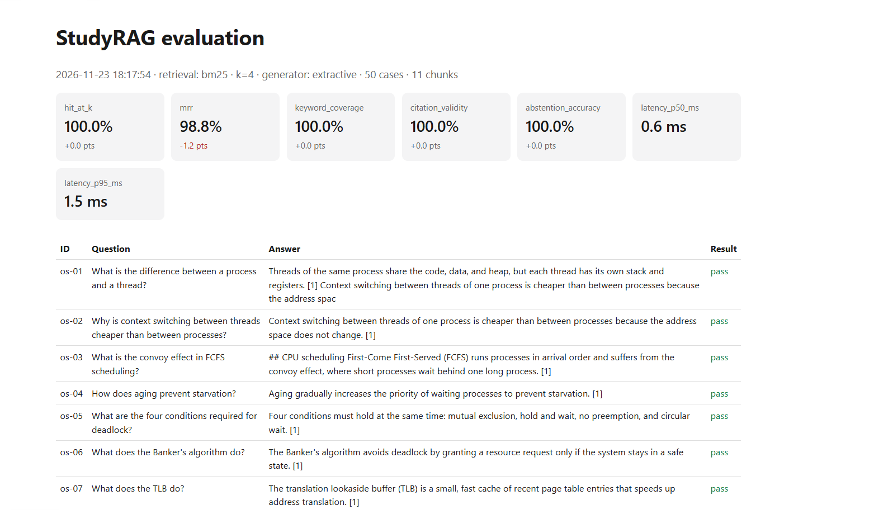
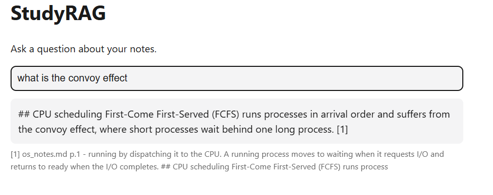

# StudyRAG

A retrieval-augmented study assistant that answers questions from your own notes **with citations**, plus an **evaluation harness** that measures answer quality and fails the build when it regresses.

Most AI demos can't tell you whether the last change made them better or worse. This one can.

## What it does

```
notes (.md/.txt/.pdf) -> chunk -> index (BM25 / dense / hybrid)
question -> retrieve top-k -> guardrail -> generate (Claude or offline) -> verify citations
```

- **Citations you can check**: every answer points to source file + page; invalid citations are detected.
- **Abstains instead of guessing**: if retrieval finds nothing relevant, it says "I don't know based on the notes" without calling the LLM (saves cost, prevents hallucination).
- **Three retrieval modes**: BM25 (zero dependencies, implemented from scratch), dense embeddings, and hybrid with reciprocal rank fusion.
- **Works offline**: with no API key it uses an extractive answerer, so tests and CI are free and deterministic. Set `ANTHROPIC_API_KEY` to switch to Claude.

## Evaluation harness

`evals/cases.jsonl` is a golden set of questions (answerable and deliberately unanswerable). Each run reports:

| Metric | Meaning |
|---|---|
| hit@k | a relevant chunk was retrieved in the top k |
| MRR | how high the first relevant chunk ranked |
| keyword coverage | expected terms appear in the answer |
| citation validity | answers cite real sources, never non-existent ones |
| abstention accuracy | answers when it should, refuses when it should |
| faithfulness (`--judge`) | LLM-as-judge: every claim supported by the sources |
| latency p50/p95 | speed |

Results are compared to `evals/baseline.json`. If any metric drops more than 2 points, or a previously passing case now fails, `--fail-on-regression` exits non-zero and **CI blocks the change**. An HTML report is written to `evals/report.html`.

### Current results (BM25 + extractive, 17 cases)

hit@k 100%, MRR 1.00, keyword coverage 100%, citation validity 100%, abstention accuracy 100%.

**Found and fixed with the harness:** `neg-03` ("fastest sorting algorithm for nearly sorted data") is not in the notes, but the single word "algorithm" matched the Banker's algorithm paragraph, so keyword retrieval answered anyway. Abstention accuracy was 94%. I added a coverage guardrail: the retrieved text must contain at least 40% of the question's key terms, otherwise the assistant abstains. Abstention accuracy went 94% -> 100% with no change to hit@k or answer quality, and `test_single_shared_word_is_not_enough_to_answer` locks it in.

**Honest caveat:** the golden set is small (17 cases), and the 0.4 threshold sits in the gap between the weakest answerable question (0.50) and the strongest unanswerable one (0.33). Growing the set to 50+ questions is the way to confirm the threshold generalises; `min_coverage` is a constructor argument.

## Quick start (Windows/WSL2 or Linux/macOS)

```bash
python -m venv .venv && source .venv/bin/activate
pip install -e ".[dev,api]"            # add ,llm for Claude and ,dense for embeddings

studyrag ingest data/notes             # or point at your own folder of notes / PDFs
studyrag ask "What is the convoy effect?"
studyrag serve                         # web UI at http://localhost:8000

# evaluation
studyrag eval                          # compare with baseline, write evals/report.html
studyrag eval --update-baseline        # accept the current numbers as the new baseline
studyrag --mode hybrid eval --judge    # semantic retrieval + LLM faithfulness check

# use Claude for answers
export ANTHROPIC_API_KEY=...
studyrag --llm claude ask "Why is context switching between threads cheaper?"
```

Docker: `docker build -t studyrag . && docker run -p 8000:8000 -e ANTHROPIC_API_KEY studyrag`

## Design decisions

- **BM25 from scratch**: no heavy dependency for a strong baseline; dense retrieval is optional.
- **Relevance by phrase, not chunk ID**: gold labels survive re-chunking experiments.
- **Abstention is a first-class metric**: a study tool that confidently invents answers is worse than none.
- **Extractive fallback**: keeps CI deterministic and free; the LLM backend sits behind the same interface.

## Screenshots




## Next steps

Add your real notes and past papers to `data/notes/`, grow `evals/cases.jsonl` to 50+ questions, compare `bm25` vs `hybrid`, and record the numbers here.
